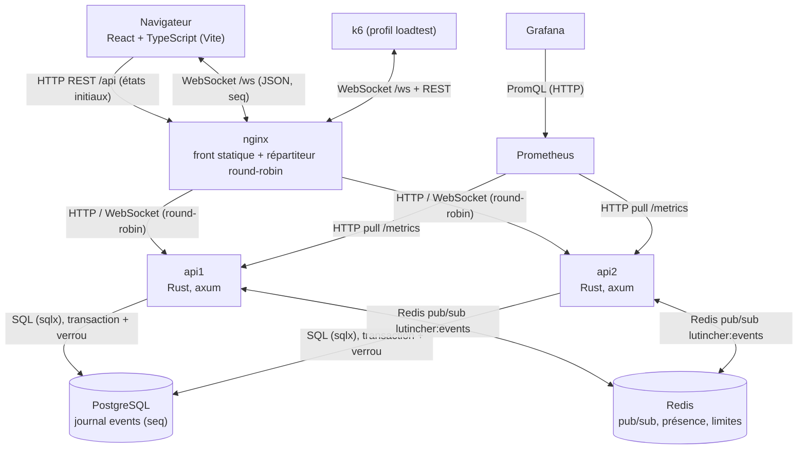

# Lutincher : dossier technique (Web Temps Réel)

XARDEL Edouard, LEBLANC Cyril et CLEMENT Jeremy · version du 2026-11-04 · plan de la fiche projet,
section « Dossier technique ».

Ce dossier remplace la version PDF du même jour, qui s'arrêtait pendant la
série « avant » 2. Toutes les mesures citées viennent de
`docs/protocole-mesure.md` (§7) et de `loadtest/results/*-analyse.md`.

---

## 1. Contexte, utilisateurs, scénario principal

Lutincher est une maison de ventes aux enchères en temps réel. On y vend des
lutins générés procéduralement. C'est le projet fil rouge du cours « Web Temps
Réel » : une application multi-utilisateurs dont l'état est partagé en direct,
puis soumise à une charge mesurée.

- **Génération** : un `seed` produit un lutin en SVG à partir de six calques
  (fond, corps, oreilles, yeux, chapeau, accessoire). La rareté est tirée en
  premier (60 / 30 / 9 / 1 %, du commun au légendaire doré), puis elle contraint
  les calques. Le même seed donne toujours le même lutin.
- **Enchères** : prix de départ, palier minimal et chrono côté serveur. Une mise
  dans les 10 dernières secondes prolonge la vente de 10 s (anti-sniping).
- **Points** : 1000 points fictifs à l'inscription. La réservation est
  implicite : un solde ne peut jamais devenir négatif.
- **Victoire** : on compare la somme des valeurs de rareté remportées
  (10, 50, 200 et 800), puis les points restants, puis le nombre de lutins.

| | Joueur (la classe) | Admin (le groupe) |
|---|---|---|
| Accès | Inscription libre, 1000 points | Compte créé au démarrage par seed |
| Peut | miser, suivre les ventes, voir sa collection et le classement | tout cela, plus générer des lutins, programmer des ventes, clôturer la partie |

**Scénario principal (5 étapes)**

1. Un visiteur crée un compte et reçoit 1000 points.
2. Un admin génère des lutins et programme une vente. Au premier démarrage, le
   seed en a déjà préparé 40 et 10 ventes.
3. La vente s'ouvre : chrono visible par tous, liste des connectés, mises en
   direct.
4. Les surenchères et les prolongations s'enchaînent jusqu'à la clôture. Le
   gagnant est débité ; les autres retrouvent leurs points réservés.
5. Le classement évolue à chaque vente. À la clôture de la partie, le podium
   s'affiche.

**Flux simulés.** Aucune API payante n'est utilisée. Les lutins sont générés
par le serveur. Les joueurs de la charge sont simulés par k6 (section 8).

---

## 2. Architecture

Le navigateur lit l'état initial en REST (`/api/auctions`, `/api/me`,
`/api/leaderboard`). Ensuite, il ne reçoit plus que les changements, sur une
seule WebSocket.

| Composant | Rôle |
|---|---|
| nginx | Sert le front. Répartit `/api` et `/ws` en round-robin. Retire une instance après un échec (`max_fails=1`, `fail_timeout=10s`), abandonne une connexion après 1 s et partage cet état entre ses workers (`zone`). |
| api1, api2 | Même binaire, aucune mémoire partagée. Chacune garde le registre de ses propres sockets. |
| PostgreSQL | Utilisateurs, lutins, ventes, mises, état de partie, et le journal `events`, avec un numéro `seq` par ligne. |
| Redis | Canal pub/sub `lutincher:events`. Présence : une clé par connexion, expirée après 25 s. Limites de débit : mises et `sync`. |
| Prometheus, Grafana | Collectent les `/metrics` des deux instances. Tableau de bord versionné « Lutincher — temps réel ». |
| k6 | Génère la charge à travers nginx, depuis le réseau Docker. |

**Chemin d'un événement.** Une mise acceptée devient un événement `bid`. Le
publisher de l'instance l'écrit dans le journal, dans une transaction tenue
sous verrou consultatif. Il le publie sur Redis dans cette même transaction,
puis valide. Redis le relaie aux deux instances, et chacune le remet à ses
connexions. Le `seq` vient du journal : il est le même quelle que soit
l'instance qui a produit l'événement.

Le lancement complet tient en une commande : `docker compose up --build`.

---

## 3. Décisions et alternatives comparées

| Sujet | Choix | Alternatives écartées | Pourquoi |
|---|---|---|---|
| Temps réel | WebSocket nu (axum) | SSE ; Socket.IO | Un seul canal bidirectionnel pour les mises et la diffusion. Reconnexion et heartbeat écrits à la main, car ils sont évalués. Trames JSON lisibles dans l'onglet Réseau. |
| Framework serveur | axum | actix-web | Écosystème tokio/tower : CORS, traces et arrêt propre déjà fournis. |
| Répartiteur | nginx | Traefik | Un fichier de configuration. Le round-robin et la bascule passive suffisent. Il sert aussi le front. |
| Persistance | PostgreSQL + sqlx | SQLite | Partagée par deux instances dès la phase 4. Transactions et verrou consultatif. |
| Ordre des événements | Journal PostgreSQL + verrou consultatif | Ordre d'arrivée sur le bus | Un seul `seq` global, identique sur toutes les instances. Il permet aussi la reprise. |
| Bus entre instances | Redis pub/sub | NATS ; Kafka | Périmètre minimal. La durabilité est portée par le journal, pas par le bus. |
| Limites de débit | Fenêtre glissante dans Redis (script Lua) | Compteur en mémoire ; middleware tower | Une seule limite pour les deux instances. |
| Présence | Une clé Redis par connexion, expiration 25 s | Liste en mémoire | Survit à la perte d'une instance et s'efface seule. |
| Format | JSON | MessagePack | Lisible dans l'onglet Réseau, critère de la phase 2. |
| Images | SVG généré côté serveur, déterministe | PNG ; API externe | Léger, vectoriel, sans service payant. Seul le manifeste des calques est stocké. |
| Mesure | Prometheus + Grafana provisionné ; k6 | Relevés à la main ; Artillery | Courbes reproductibles, tableau de bord versionné. k6 parle WebSocket nativement. |
| Optimisation | Journal par lots | Compression ; lot du classement ; MessagePack | Tout événement passe par le journal. C'est le seul chemin commun à toutes les mises. |

---

## 4. Contrat de messages

Le canal est une WebSocket en JSON typé : le champ `type` dit ce qu'est le
message. Chaque événement diffusé porte un `seq` tiré du journal. Ce numéro
croît strictement, et le client ignore tout `seq` déjà reçu. Le détail des
messages, avec des exemples, est dans `docs/protocole-websocket.md`.

**Client vers serveur**

| Type | Champs | Exemple |
|---|---|---|
| `bid` | `auction_id`, `amount` | `{"type":"bid","auction_id":"…","amount":120}` |
| `sync` | `last_seq` | `{"type":"sync","last_seq":41}` |
| `ping` | — | `{"type":"ping"}`, envoyé toutes les 10 s, sans réponse |

Un champ inconnu fait refuser le message (`deny_unknown_fields`).

**Serveur vers client**

| Type | Destinataire | Contenu |
|---|---|---|
| `auction_started` | tous | vente ouverte : lutin, prix de départ, chrono |
| `bid` | tous | mise acceptée : vente, montant, auteur, `ends_in_s` |
| `outbid` | ancien meneur | vente, auteur de la surenchère, montant |
| `auction_ended` | tous | gagnant et montant, ou rien si personne n'a misé |
| `presence` | tous | joueurs connectés |
| `leaderboard` | tous | classement live |
| `game_closed` | tous | podium final |
| `sync` | demandeur | événements manqués, puis le `seq` du dernier |
| `error` | demandeur | `code` et `detail` |

Exemple : `{"type":"bid","auction_id":"…","amount":120,"bidder":"lea","ends_in_s":42,"seq":57}`.

Codes d'erreur : `forbidden`, `bid_too_low`, `insufficient_funds`,
`auction_not_open`, `malformed_message`, `message_too_large`, `rate_limited`.

**Écarts connus**

- Une erreur consomme un numéro `seq` : elle est écrite au journal, puis exclue
  du rejeu. Les numéros ont donc des trous, sans effet sur le filtrage des
  doublons.
- Chaque changement de présence consomme aussi un `seq`.
- Il n'y a pas de `pong` : le client ne voit une connexion morte que lorsque la
  socket se ferme.

---

## 5. Sécurité

- **Mots de passe** : hachés avec Argon2id, sel aléatoire, au format PHC.
- **Jetons** : JWT HS256 valable 24 h. Le secret vient de `JWT_SECRET`. Le
  fichier `docker-compose.yml` contient une valeur de démonstration, à changer
  avant toute exposition.
- **Authentification de la WebSocket** : le jeton est vérifié à la poignée de
  main. Une connexion sans jeton valide est refusée. Le jeton passe dans l'URL
  (`/ws?token=`), car un navigateur n'envoie pas d'en-tête personnalisé sur une
  WebSocket. Il peut donc apparaître dans les journaux d'accès.
- **Jeton expiré (T2)** : le client lit `exp` dans le jeton. À l'échéance, ou au
  chargement si elle est déjà passée, il ferme la session et affiche « Votre
  session a expiré ». Il ne relance plus la socket avec un jeton mort. Le
  serveur reste l'autorité : il refuse de toute façon un jeton expiré.
- **Origine** : une origine présente mais absente de `ALLOWED_ORIGINS` est
  refusée à la poignée de main. Une requête sans en-tête `Origin` passe, ce qui
  laisse entrer les clients qui ne sont pas des navigateurs (k6, scripts) : le
  contrôle n'est pas strict.
- **Validation** : chaque message est décodé selon un schéma strict. Au-delà de
  512 octets, il est rejeté avec `message_too_large`. Un JSON invalide ou une
  trame binaire donne `malformed_message`. Dans les deux cas, la connexion et le
  serveur restent en service.
- **Limites de débit** (Redis, communes aux deux instances) :
  - 5 mises par 10 s et par utilisateur, toutes ventes confondues. Une mise
    refusée par la limite n'est pas comptée.
  - 10 `sync` par 10 s et par utilisateur, car un rejeu lit le journal. Testé
    en direct : sur 12 demandes rapides, 10 rejeux puis 2 `rate_limited`.
- **SQL** : requêtes paramétrées (sqlx, liaisons `$1`).
- **Non traité** : pas de TLS dans la stack locale, pas de limite sur les
  tentatives de connexion. Le compte `admin` a un mot de passe de démonstration.

---

## 6. Robustesse : reconnexion, reprise, présence

- **Reconnexion** : le client attend 1 s, puis double le délai à chaque échec,
  jusqu'à 30 s, avec une gigue de ±20 %. Un bandeau signale la reconnexion.
- **Reprise** : à la reconnexion, le client envoie `sync` avec son dernier
  `seq`. Le serveur rejoue le journal, par lots de 500, dans une seule
  enveloppe. Les doublons sont écartés par `seq`.
- **Présence** : un `ping` toutes les 10 s. Une connexion se tait-elle 25 s, sa
  clé expire. Un onglet fermé proprement disparaît tout de suite ; un onglet
  tué, en 25 s au plus.
- **Perte du bus Redis** : l'instance ferme toutes ses connexions locales. Les
  clients se reconnectent et rattrapent ce qu'ils ont manqué. Testé en coupant
  la connexion Redis (`CLIENT KILL`).
- **Arrêt d'une instance** : voir la section 7, test 7/7 sous Docker.
- **Notifications (J7)** : « tu as été surenchéri » arrive par l'événement
  `outbid`. « Vente sur le point de se clôturer » est un bandeau affiché pendant
  les 10 dernières secondes. Il est calculé par le client à partir de
  l'échéance que donne le serveur.
- **Fin de partie** : une fois la partie close, le serveur refuse les mises,
  même si le client n'a pas encore reçu `game_closed`.
- **Arrêt propre** : sur Ctrl-C, le serveur termine les requêtes en cours.
- **Client lent** : la diffusion ne bloque jamais. Un client dont le tampon
  (32 trames) est plein perd des trames, sans resynchronisation automatique
  tant qu'il reste connecté.

---

## 7. Passage à l'échelle : broker, instances, garanties

- **Deux instances** (`api1`, `api2`) derrière nginx. `/api/healthz` dit quelle
  instance répond, et chaque ouverture de socket est journalisée avec son
  instance.
- **Broker** : Redis pub/sub. Il ne garde rien : la durabilité et l'ordre
  viennent du journal PostgreSQL.
- **Garantie annoncée** : en direct, chaque connexion reçoit chaque événement
  *au plus une fois*. Après une reconnexion, le rejeu donne *au moins une fois*
  chaque événement manqué. Les doublons sont filtrés par `seq` côté client.
  L'ordre est celui du journal, le même pour tous.

**Test de bascule sous Docker** (`loadtest/scripts/failover.mjs`, 2026-11-04) :

| Contrôle | Résultat |
|---|---|
| Quatre clients connectés via nginx | réussi |
| Une vente ouverte | réussi (vente du seed) |
| Mise diffusée aux quatre clients, répartis sur deux instances | réussi |
| `docker compose kill api1` : les clients d'api1 tombent | réussi (2 clients sur 4) |
| Tous les clients reconnectés sur api2 en moins de 30 s | réussi |
| Resynchronisation après bascule | réussi (0 événement à rattraper : rien n'a été publié pendant la coupure) |
| Mise diffusée après bascule aux quatre clients | réussi |

Le premier essai échouait au cinquième contrôle, pour deux raisons. Un
conteneur tué ne renvoie aucun refus TCP : nginx attendait environ 14 s avant
d'essayer l'autre instance. Et chaque worker nginx découvrait la panne de son
côté. Corrections : `proxy_connect_timeout 1s` et une `zone` partagée sur
l'upstream. Après correction, la première requête qui suit la coupure répond en
1,1 s, les suivantes tout de suite.

**Limite du test** : le rattrapage n'a rien eu à rejouer. Un rejeu avec contenu
a été vérifié lors de la perte du bus Redis (section 6), pas pendant cette
bascule.

---

## 8. Mesures

### Protocole (fixé avant la première mesure)

- **Machine** : portable Ryzen 5 5600H (6 cœurs, 12 threads), 15,3 Gio de RAM,
  Windows 11, Docker Desktop (WSL2). Générateur, instances et base tournent sur
  le même PC : les chiffres absolus sont pessimistes, et seules les comparaisons
  avant / après ont un sens.
- **Scénario** (`loadtest/bidders.js`) : un palier compte des spectateurs, des
  sockets qui écoutent comme un onglet de la salle. Cinq enchérisseurs misent
  toutes les 2,5 s sur 12 ventes (incrément 1). Les paliers sont 10, 50, 100
  puis 200 spectateurs. Chacun tient 3 min après une rampe de 20 s, et la rampe
  est exclue des résultats. Une série dure 13 min 20 s.
- **Point d'horodatage** : k6 mesure de bout en bout, entre l'envoi d'une mise
  acceptée et la réception de sa diffusion sur la même socket. Le serveur mesure
  aussi la latence de la publication à la remise
  (`lutincher_broadcast_latency_seconds`).
- **Remise à zéro** avant chaque série (`docker compose down -v`), puis export
  des courbes avant la remise suivante.
- **Critère de dégradation** : p95 supérieur à 1000 ms, ou plus de 1 % d'erreurs
  WebSocket sur la fenêtre de 3 min.
- **Répétition** : deux séries par configuration, on compare les médianes.

### Résultats (p50 / p95 en ms, médiane de deux séries)

| Spectateurs | Connexions | Avant p50 / p95 | Après p50 / p95 | Trames/s (serveur) | Mises acceptées/s |
|---|---|---|---|---|---|
| 10 | 15 | 20,3 / 42,6 | 17,5 / 33,3 | 27 à 28 | 1,7 |
| 50 | 55 | 22,0 / 35,5 | 20,0 / 32,0 | 95 à 102 | 1,7 à 1,8 |
| 100 | 105 | 23,5 / 39,0 | 21,0 / 33,0 | 175 à 189 | 1,6 à 1,7 |
| 200 | 205 | 28,0 / 46,8 | 26,0 / 40,0 | 343 à 348 | 1,7 |

Les valeurs série par série sont dans le protocole, §7.

- **Seuil de dégradation : non atteint.** À 205 connexions, le p95 reste sous
  50 ms, très loin de 1000 ms. Aucune erreur WebSocket dans les quatre séries.
  Le point de rupture est donc au-delà de 205 connexions avec ce débit de
  mises : on ne peut pas le chiffrer avec cette campagne.
- **Latence serveur** : 1,0 ms en p95 à tous les paliers, avant comme après.
  L'essentiel du temps de bout en bout se passe hors de la diffusion :
  traitement de la mise, journal, réseau Docker et nginx.

### Optimisation : écriture du journal par lots

Avant, chaque événement ouvrait sa propre transaction (verrou, INSERT, PUBLISH,
COMMIT). Après, le publisher prend tous les événements déjà en file, jusqu'à 64,
et les écrit en une seule transaction. La méthode de mesure est identique avant
et après.

| Spectateurs | p95 avant (série 1 / série 2) | p95 après (série 1 / série 2) | Gain sur les médianes |
|---|---|---|---|
| 10 | 52,1 / 33,0 | 32,6 / 34,0 | 21,7 % (non concluant) |
| 50 | 37,0 / 33,9 | 34,0 / 30,0 | 9,7 % (non concluant) |
| 100 | 39,0 / 39,0 | 35,0 / 31,0 | 15,4 % |
| 200 | 48,6 / 44,9 | 43,0 / 37,0 | 14,4 % |

**Interprétation, volontairement prudente**

- Aux paliers 100 et 200, chaque valeur après est sous chaque valeur avant :
  c'est là que le protocole prévoyait un effet. Avec deux séries par groupe, un
  tel ordre arrive pourtant par hasard une fois sur six. C'est un indice, pas
  une preuve.
- Aux paliers 10 et 50, rien n'est établi. Le gain de 21,7 % à 10 vient surtout
  de la série avant 1, très au-dessus de la série avant 2.
- Les lots comptent 1,98 et 1,85 événement en moyenne. Le protocole attendait
  des lots d'un seul événement à faible charge, et c'était faux : une mise
  acceptée publie `bid` puis `outbid` à la suite, et les deux partent ensemble.
- Écarts relevés pendant la série après 2 : 210 sessions k6 au lieu de 205,
  dont 5 ouvertes à la toute fin, hors des fenêtres de mesure. Un navigateur
  était aussi connecté au palier 200 (206 connexions). Ces écarts sont détaillés
  dans le protocole, §7.

---

## 9. Limites et pistes

**Limites de la mesure**

- Une seule machine pour tout. La charge est faible (environ 2 mises par
  seconde) et le serveur n'est pas saturé : le seuil de dégradation n'est pas
  trouvé.
- Deux séries par configuration seulement, et un seul scénario. La montée en
  charge des mises seules n'est pas mesurée.
- nginx a été modifié après les mesures (délai de connexion, zone partagée).
  Cela ne change rien hors panne, mais une nouvelle série devra refaire aussi
  les séries « avant ».

**Limites du produit**

- Le jeton est dans l'URL de la WebSocket, et le secret JWT est une valeur de
  démonstration. Pas de TLS, pas de limite sur les tentatives de connexion.
- Une requête sans en-tête `Origin` est acceptée.
- La limite de mises est par utilisateur et non par vente, alors que le cahier
  la demande par vente. Il n'y a pas de limite globale.
- Un `sync` refusé par la limite n'est pas retenté par le client : son
  rattrapage est alors perdu jusqu'à la reconnexion suivante.
- Un client lent mais toujours connecté perd des trames sans se resynchroniser.
- Pas de `pong`. Les erreurs et la présence consomment des numéros du journal.
- L'alerte J7 est seulement visuelle : pas de notification système, rien hors
  de la salle de vente.
- Si un conteneur api est recréé, nginx peut garder son ancienne adresse et il
  faut relancer le front. Ce cas n'est pas vérifié sous Docker. Le simple
  redémarrage d'une instance après `kill`, lui, a été vérifié.
- Hors périmètre, comme prévu au cahier : revente entre joueurs, enchère
  automatique, messagerie.

**Pistes**

- Jeton dans un sous-protocole WebSocket ou un cookie `HttpOnly`, TLS devant
  nginx, limite des tentatives de connexion.
- Un `pong`, et une resynchronisation déclenchée quand le client détecte un
  trou dans les `seq`.
- Présence hors du journal, pour qu'elle ne consomme plus de numéros.
- Une campagne de charge plus lourde (plus d'enchérisseurs, une machine pour le
  générateur) pour trouver le seuil de dégradation, puis tester la compression
  par message et MessagePack si la mesure le justifie.

---

## 10. Annexe : usage de l'IA et tableau comparatif

**USAGE-IA.md**, à la racine du dépôt, décrit les outils et modèles, le journal
des interventions, les réponses refusées et le bilan. Les défauts trouvés et
corrigés pendant le projet :

- un émetteur cloné qui empêchait la resynchronisation après la perte du bus ;
- des compteurs Prometheus absents au démarrage ;
- un scénario de charge où deux sockets partageaient un compte et sa limite de
  mises ;
- une boucle de fin de test k6 ;
- un test de bascule qui visait la mauvaise URL, et un nginx qui mettait plus de
  30 s à basculer.

**Ligne du tableau comparatif**

| Technique | Broker | Instances | Outil de charge | Connexions avant dégradation | p50 / p95 | Débit | Optimisation et gain |
|---|---|---|---|---|---|---|---|
| WebSocket (axum, JSON) | Redis pub/sub + journal PostgreSQL | 2, derrière nginx | k6 1.8.2 | non atteinte : plus de 205 (p95 de 40 ms à 205) | 26 / 40 ms à 205 connexions (après optimisation) | environ 345 trames/s et 1,7 mise/s à 205 connexions | journal par lots : p95 −14,4 % à 200 spectateurs, −15,4 % à 100 ; non concluant à 10 et 50 |
