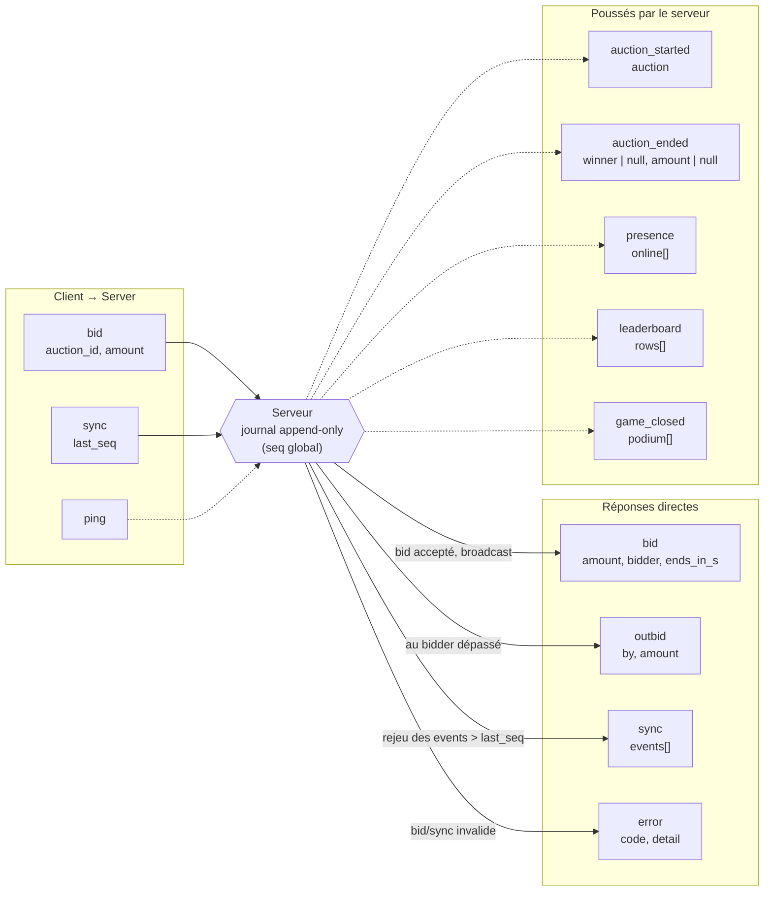
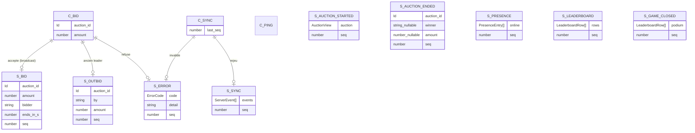

# Protocole WebSocket des enchères

Chaque event serveur porte le numéro de séquence global (`seq`) du journal append-only.

## 1. Vue d'ensemble

## 2. Schéma des messages

> `string_nullable` / `number_nullable` remplacent `string | null` / `number | null` (le `|` n'est pas accepté dans un type Mermaid).

## 3. Client → Serveur

| Type | Champs | Rôle |
|---|---|---|
| `bid` | `auction_id`, `amount` | Placer une enchère |
| `sync` | `last_seq` | Demander le rejeu des events manqués |
| `ping` | - | Heartbeat toutes les 10 s : renouvelle la présence du client (expiration à 25 s sans ping) |

## 4. Serveur → Client

| Type | Champs | Portée | Déclencheur |
|---|---|---|---|
| `auction_started` | `auction: AuctionView`, `seq` | Broadcast | Nouvelle enchère ouverte |
| `bid` | `auction_id`, `amount`, `bidder`, `ends_in_s`, `seq` | Broadcast | Enchère acceptée |
| `auction_ended` | `auction_id`, `winner: string \| null`, `amount: number \| null`, `seq` | Broadcast | Fin d'enchère (`null` si aucune mise) |
| `outbid` | `auction_id`, `by`, `amount`, `seq` | Individuel | Le bidder est dépassé |
| `presence` | `online: PresenceEntry[]`, `seq` | Broadcast | Changement de joueurs connectés |
| `leaderboard` | `rows: LeaderboardRow[]`, `seq` | Broadcast | Classement mis à jour |
| `game_closed` | `podium: LeaderboardRow[]`, `seq` | Broadcast | Fin de partie |
| `sync` | `events: ServerEvent[]`, `seq` | Individuel | Réponse à `sync` client |
| `error` | `code: ErrorCode`, `detail`, `seq` | Individuel | Requête invalide |

## 5. Correspondance requête → réponse

| Message client | Réponse serveur |
|---|---|
| `bid` | `bid` (broadcast) + `outbid` (à l'ancien leader), ou `error` (`rate_limited` au-delà de 5 mises par 10 s et par utilisateur) |
| `sync` | `sync`, ou `error` (`rate_limited` au-delà de 10 `sync` par 10 s et par utilisateur) |
| `ping` | Aucune (pas de `pong` typé) |

## 6. Problèmes identifiés

| Problème | Impact | Correction |
|---|---|---|
| Pas de `pong` | Impossible de mesurer la latence ou détecter une connexion morte côté client | Ajouter `{ type: 'pong' }` |
| `seq` sur `error` | Une erreur individuelle consomme un numéro du journal global | Retirer `seq` ou le rendre optionnel |
| `sync` récursif | `events` peut contenir un `sync` | Typer `events: Exclude<ServerEvent, { type: 'sync' }>[]` |
| `presence` avec `seq` | Pollue le journal si fréquent | Sortir du journal ou throttler |
| `bid` + `outbid` | L'ancien leader reçoit les deux | Vérifier que c'est voulu |
